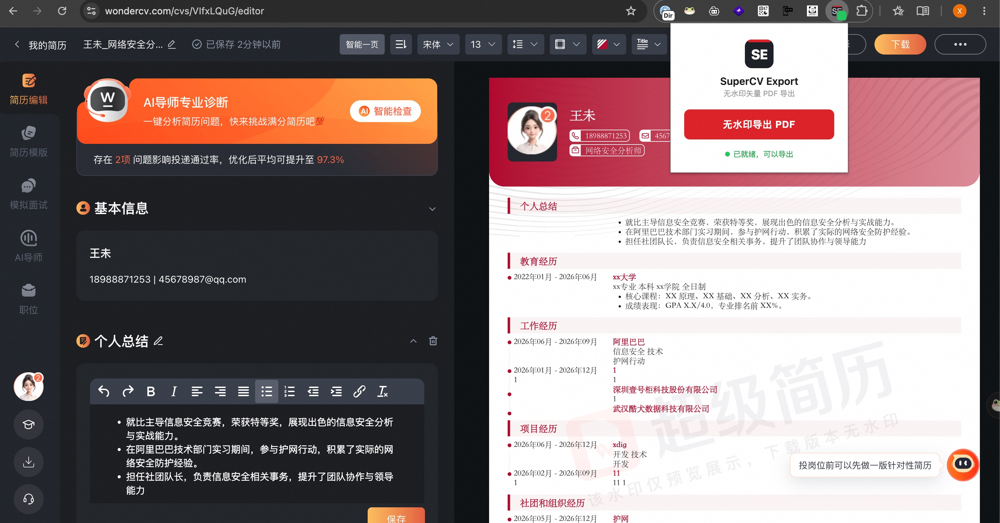
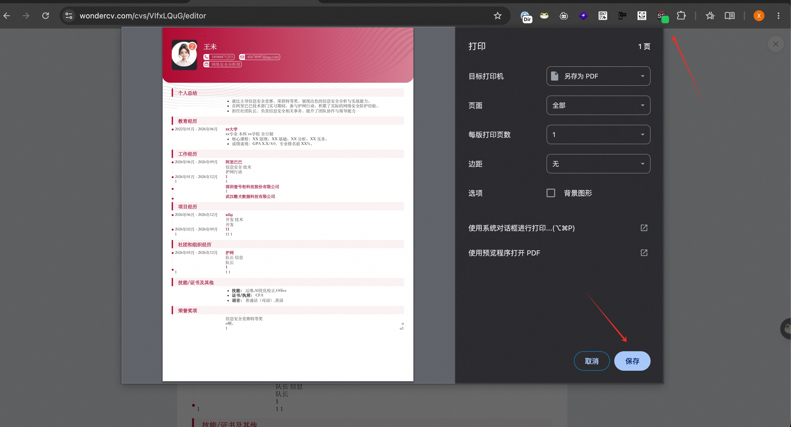

# SuperCV Export

一键导出超级简历（WonderCV）为**无水印矢量 PDF**。

> Chrome 扩展 · 点击即用 · 模板样式完整保留

---

## 📦 安装教程

1. 下载本仓库（`git clone` 或下载 ZIP 后解压）
2. 打开 Chrome，地址栏输入 `chrome://extensions/` 回车
3. 打开右上角的 **开发者模式** 开关
4. 点击左上角 **加载已解压的扩展程序**，选择本项目的 `SuperCV-Export-main` 文件夹
5. 点击浏览器工具栏右侧的 **拼图图标** 🧩，找到 **SuperCV Export**，点旁边的 **图钉** 📌 把它固定到工具栏

安装完成，工具栏上会出现 SE 图标。

---

## 🚀 使用教程

### 第 1 步：进入简历编辑页

在超级简历官网打开你的简历，进入**编辑页面**（地址栏网址形如 `https://www.wondercv.com/cvs/xxx/editor`）。

> ⚠️ 只有在简历编辑页才能导出。官网首页、模板列表页等其他页面均不可导出。

### 第 2 步：确认图标绿点

看工具栏上的 SE 图标：

| 图标状态 | 含义 | 能否导出 |
|---|---|---|
| 右下角有 **绿色小点** | 当前页面已就绪 | ✅ 可以 |
| 没有绿点 | 当前页面不是简历编辑页 | ❌ 按钮禁用 |

绿点会在你进入编辑页后 1~2 秒内自动出现，离开编辑页自动消失，**无需手动刷新页面**。

### 第 3 步：导出

点击 SE 图标，在弹出的面板中点击 **「无水印导出 PDF」** 按钮。

- 按钮下方显示 `已就绪，可以导出` → 正常点击即可
- 按钮灰色不可点并提示 `请进入简历编辑页后使用` → 回到第 1 步

点击后页面会显示导出预览，并自动弹出打印对话框。

最后点击 **保存**，选择位置即可得到无水印矢量 PDF。

---

## ❓ 常见问题

**Q1：图标上没有绿点？**
- 确认当前在简历编辑页（网址含 `/cvs/xxx/editor`）
- 刚切换到编辑页时稍等 1~2 秒，绿点会自动出现
- 如果一直没有，刷新一下页面即可

**Q2：导出按钮是灰的，点不了？**
- 按钮和绿点联动：只有绿点出现时按钮才可点击。回到简历编辑页再试

**Q3：导出的 PDF 背景/渐变/花纹不见了？**
- 打印对话框里没有勾选 **「背景图形」**，重新导出并勾选（见第 4 步）

**Q4：导出的 PDF 边缘有空白？**
- 确认打印设置的 **边距 = 无**、纸张 = **A4**（见第 4 步）

**Q5：支持哪些浏览器？**
- Chrome、Edge 及其他 Chromium 内核浏览器的较新版本

**Q6：导出的 PDF 可以编辑文字吗？**
- 可以。导出的是矢量 PDF，文字可选择、可复制、可搜索，无限缩放不失真

---

## ⚠️ 声明

仅供学习研究用途，请尊重超级简历平台的服务条款与版权。

## 📄 License

MIT
